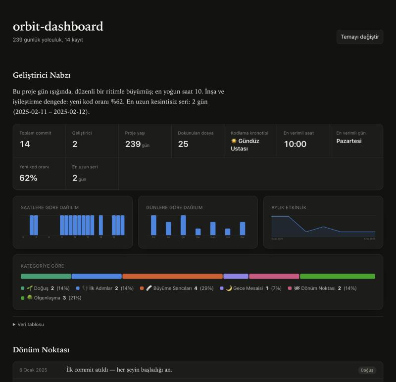
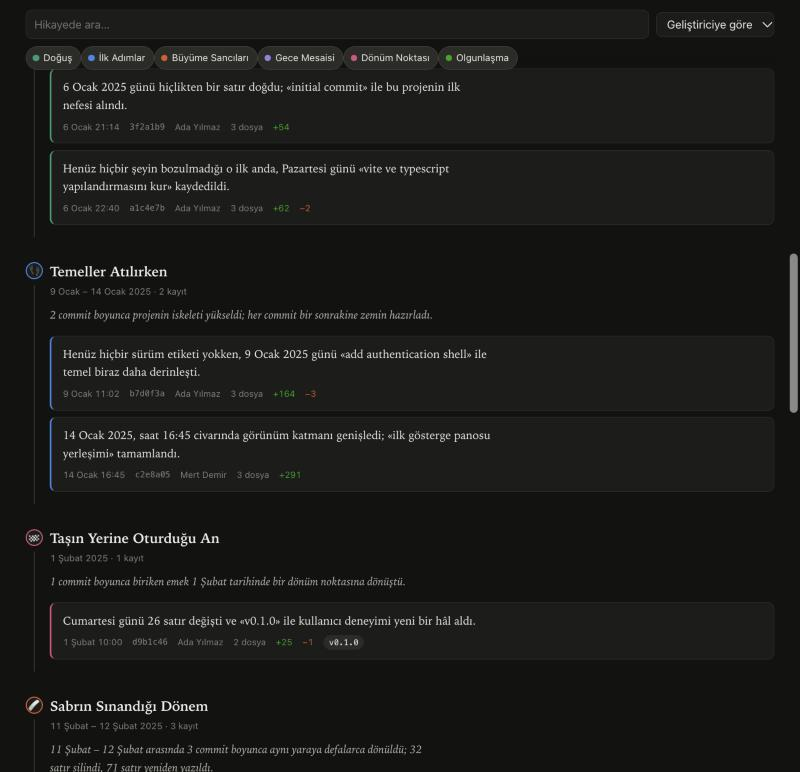
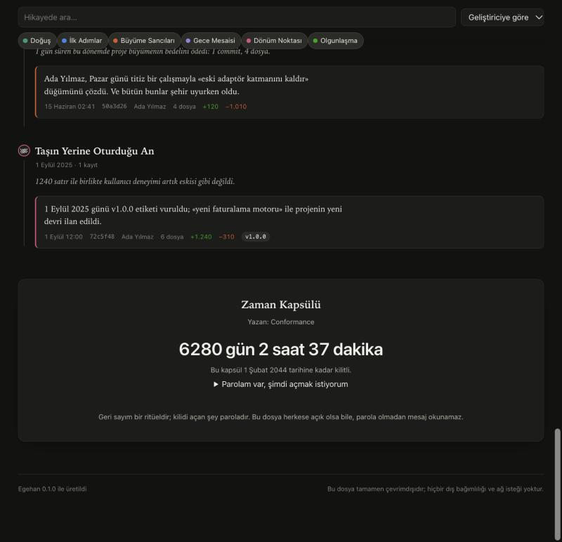
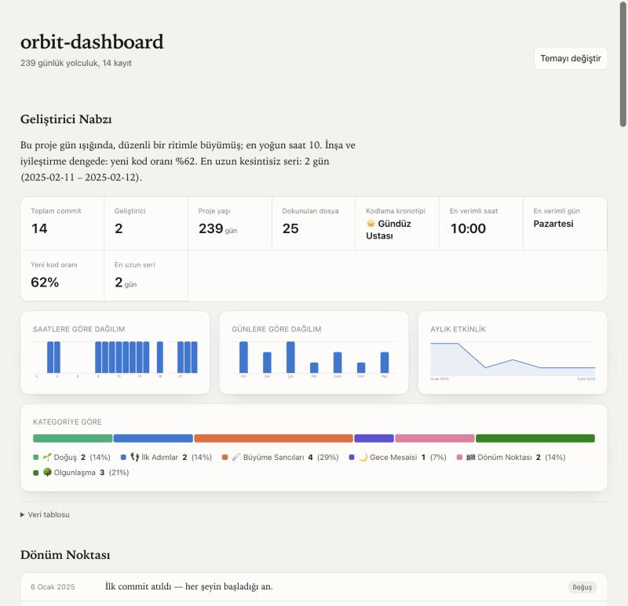

<div align="center">

# Egehan

**Turn a project's cold `git log` into a living chronicle — offline, deterministic, no API key.**

[](LICENSE)
[](package.json)
[](packages/dotnet-tool)

[Türkçe](README.tr.md) · [Architecture](docs/ARCHITECTURE.md) · [Contributing](CONTRIBUTING.md)

</div>

---

Every repository already contains a story: the night a race condition was finally cornered, the week
everything broke at once, the commit that deleted a thousand lines and made the project better. `git log`
records all of it and tells none of it.

Egehan reads that history and writes the story down — as a Markdown chronicle you can commit and an
interactive single-file HTML timeline you can open anywhere. It runs entirely on your machine with **no
LLM, no API key and no network access**, and the same commit always produces the same sentence.

## Why no AI

A keepsake should still work in ten years, on a plane, in a repository nobody is allowed to upload
anywhere. So the narration is a rule engine over commit metadata, not a model:

- **Deterministic.** The chosen sentence is `parseInt(sha[0..8], 16) % variants.length`. Re-running the
  tool never rewrites history, so the generated files produce clean, reviewable diffs.
- **Offline.** No requests, ever. Nothing about your repository leaves your machine.
- **Private by default.** Author e-mail addresses are redacted out of the generated artifacts before
  anyone can accidentally publish them.
- **Auditable.** Every threshold lives in one readable JSON file, not scattered through code.

## What it produces

**A classified, narrated history.** Each commit is placed in one of six chapters — `birth`,
`first-steps`, `growing-pains`, `midnight-oil`, `milestone`, `evolution` — and narrated in one of three
tones (`poetic`, `minimalist`, `humorous`) in Turkish or English.

```text
Raw:    fix: token refresh race condition   (2026-03-14 03:18, 4 files, +85/-42)

Poetic: 14 Mart gecesi saat 03:18 sularında, herkes uyurken 4 dosyada titiz bir
        çalışma yapıldı; «token refresh race condition» ile sistemin nefesi düzeltildi.
```

**A Developer Pulse.** Coding chronotype (night owl, early architect, …), most productive day and hour,
the ratio of code created to code refined, and your longest unbroken commit streak.

**A living chronicle.** One `egehan hook install` and every later commit quietly updates the story. In
VS Code and Visual Studio a status bar entry keeps the pulse visible and milestones announce themselves.

A rendered example is committed at [docs/example-chronicle.md](docs/example-chronicle.md) — generated
from the conformance fixture by the tool itself, so it is always what the current engine produces.

## What it looks like

<p align="center">
  
</p>

The timeline narrates each commit in the project's own language and tone, grouped into chapters:

<p align="center">
  
</p>

A sealed time capsule counts down at the foot of the page — and says plainly that the countdown is
the ritual and the passphrase is the lock:

<p align="center">
  
</p>

Light and dark both ship, and the page follows the reader's system setting unless they choose:

<p align="center">
  
</p>

## Project status

Egehan is being built in phases, and this table is the honest state of each one. Nothing is listed as
done before its tests are.

| Phase | Deliverable                                                                             | Status                             |
| ----- | --------------------------------------------------------------------------------------- | ---------------------------------- |
| 1     | `core-spec` — report schema, engine rules, narrative dictionaries, conformance fixtures | **done**                           |
| 1     | `egehan` npm CLI — git reader, story engine, Markdown renderer, Developer Pulse         | **done**                           |
| 1     | `egehan-book.html` — the single-file interactive timeline, pure SVG, offline            | **done**                           |
| 1     | `egehan capsule` — passphrase-sealed message, opened in the browser by Web Crypto       | **done**                           |
| 1     | `egehan hook install` — the chronicle that keeps itself up to date                      | **done**                           |
| 2     | VS Code extension — status bar, timeline panel, milestone notifications                 | **done**                           |
| 3     | `Egehan.Core` — the .NET engine, proved against the Node engine's own fixtures          | **done**                           |
| 3     | `Egehan.Cli` — the NuGet global tool (`net8.0` + `net10.0`)                             | **done**                           |
| 4     | Visual Studio 2022+ extension                                                           | **not planned for v1** — see below |

### Why there is no Visual Studio extension

Visual Studio's extension model is a different thing from VS Code's — C# against the VSSDK,
buildable only on Windows, published to a separate marketplace. Shipping one would mean shipping
a deliverable that cannot be verified on the machine this project is maintained from, and a
release is not improved by adding the one piece nobody checked.

.NET developers lose very little: `dotnet tool install -g Egehan.Cli` gives them the whole command
surface, and the generated HTML timeline opens in Visual Studio as readily as in a browser. What
is missing is an in-IDE status bar, which is a convenience rather than the product.

If it is ever worth building, it is a thin shell over `Egehan.Core` — the engine, the contract, the
hooks and the capsule are already in C# and already tested. That is the whole point of keeping the
rules in data and the engine in a library.

## The command contract

Both the Node CLI and the .NET tool expose the same surface, because a team with a React front end and a
.NET back end should not have to learn two tools:

```bash
egehan init                                  # interactive setup, writes .egehanrc.json
egehan generate --format both                # EGEHAN.md + egehan-chronicle.html
egehan generate --since v1.0.0 --output docs # a chapter of its own
egehan hook install                          # keep the chronicle updating on every commit
egehan hook status                           # where the hooks live, and who else owns them
egehan hook uninstall                        # remove them, leaving your other hooks alone
egehan stats                                 # the Developer Pulse, in the terminal
egehan capsule --unlock-date 2044-02-01      # a passphrase-sealed letter to the future
```

## Repository layout

```text
packages/core-spec     # data only: schema, rules, dictionaries, HTML template, fixtures
packages/node-cli      # the `egehan` npm package
packages/dotnet-tool   # Egehan.Core + Egehan.Cli (NuGet global tool)
extensions/            # VS Code extension and Visual Studio VSIX
docs/ARCHITECTURE.md   # the decisions behind all of the above, and why
```

The rules and the narrative templates live in `core-spec` as **data, not code**, so that neither engine
can quietly become the specification while the other drifts behind it. See
[docs/ARCHITECTURE.md](docs/ARCHITECTURE.md).

## Adding your language

`core-spec/dictionary/` holds one JSON file per language. Copy `narratives.en.json`, translate it, run
`npm run spec:validate`, and both engines pick your language up with no code change. The validator
refuses a file whose structure drifts from the reference or whose templates interpolate a variable the
engine does not provide.

## About the time capsule

`egehan capsule` encrypts a message with a passphrase (PBKDF2-SHA-256, 600 000 iterations → AES-256-GCM)
and the HTML timeline counts down to its unlock date. Be clear-eyed about what that does and does not
mean: **the countdown is a ritual, the passphrase is the lock.** The ciphertext travels inside a file you
may well publish, so anything the file could decrypt on its own, any reader could decrypt too. That is
precisely why a passphrase-free capsule mode does not exist. Capsule files are never git-tracked by
default.

## License

MIT — see [LICENSE](LICENSE).
