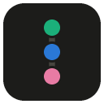

# Egehan for VS Code

Turns your repository's git history into a living chronicle — in the status bar, and in an
interactive timeline one click away. Everything happens on your machine: **no LLM, no API key, no
network request.**

## What it does

**A pulse in the status bar.** `🌱 Egehan: 142. Gün • 318 Commit` — how old the project is and how
much is in it, in the language the chronicle is written in. Hovering shows your coding chronotype,
your most productive hour and your longest streak. Clicking opens the timeline.

**An interactive timeline in the editor.** Chapters, charts, filters and search over the whole
history, rendered from the same single-file page the CLI writes.

**Quiet milestone notifications.** The 100th commit, a new release tag, a problem solved at three
in the morning. The first run records what already happened without saying anything — a four-year-old
repository does not need to announce four years of history the moment you install an extension.

## Commands

| Command                             | What it does                                                       |
| ----------------------------------- | ------------------------------------------------------------------ |
| `Egehan: Open the Timeline`         | Opens the chronicle in an editor tab                               |
| `Egehan: Write the Chronicle Files` | Writes `EGEHAN.md` and `egehan-chronicle.html` into the repository |
| `Egehan: Show the Developer Pulse`  | A one-line summary of how this project was built                   |
| `Egehan: Install the Git Hooks`     | Keeps the chronicle updating after every commit                    |
| `Egehan: Refresh`                   | Re-reads the history now                                           |

## Settings

| Setting                           | Default |                                               |
| --------------------------------- | ------- | --------------------------------------------- |
| `egehan.language`                 | `auto`  | `auto` follows the project's `.egehanrc.json` |
| `egehan.tone`                     | `auto`  | `poetic`, `minimalist` or `humorous`          |
| `egehan.statusBar.enabled`        | `true`  |                                               |
| `egehan.statusBar.alignment`      | `left`  |                                               |
| `egehan.notifications.milestones` | `true`  |                                               |
| `egehan.refreshOnGitChange`       | `true`  | Refreshes when `HEAD` moves                   |
| `egehan.maxCommits`               | `5000`  | Keeps very large repositories responsive      |

`language` and `tone` default to `auto` on purpose. The chronicle is a file the whole team commits,
so if one person's editor narrated it differently, the file would flip back and forth in the diff.
Change them in `.egehanrc.json` to change them for everyone; change them here only for yourself.

## What it does not do

- It makes **no network requests**, and has no telemetry.
- It **never writes to your repository** unless you ask. The status bar and the timeline are
  read-only; only `Write the Chronicle Files` and the git hooks produce files, and nothing is ever
  staged or committed for you.
- It stays off in untrusted and virtual workspaces, because it runs `git` and reads your project's
  configuration.

## Requirements

VS Code 1.94 or newer, and `git` on your PATH.

## License

MIT. Part of the [Egehan](https://github.com/bedirhangurler/egehan) project.
